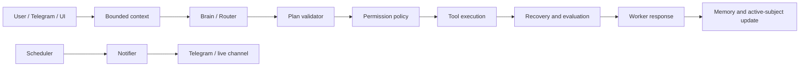

# Ciel 2.0

Ciel is a modular personal AI assistant that can converse, use tools, retain bounded
context, continue multi-step work, and send proactive Telegram notifications. Its
maintained topology uses two model identities:

- **Brain/Router** — intent classification, planning, and result evaluation.
- **Worker** — conversation, generation, synthesis, and formatting.

Optional Router Assistant and Middleware code remains available for experiments, but
both are disabled by default and reuse one of the two standard model identities.

> Experimental personal-agent software. Review the safety model before connecting
> production accounts or enabling unattended execution.

## Current baseline

- Level A and Level B: **pass**.
- Deterministic multi-tool plan validation: **pass**.
- Bounded Active Subject handoff for follow-up turns: **pass**.
- Monthly and weekly planner: **unit-tested, deployed, and live-notification tested**.
- One-time reminders: **deterministic storage/delivery regression tested**.
- Proactivity (P1.2) and user model (P1.3): **pass** — weekly plans delivered every
  Monday since 2026-09-07 on the VPS with no repeat or cooldown spam.
- Email: Markdown tables/headings/lists render as HTML; Ciel reports "sent" only after
  Gmail returns a Message Id **and** the message is fetched back by that id.
- Multi-tool branches remain raw until one final Worker synthesis; failed dependencies
  stop their consumers, and Gmail reads sharing one API client stay sequential.
- Provider timeouts return an explicit incomplete-turn response instead of leaving a
  misleading `Processing...` state; router audit decisions are normalized JSON.
- Telegram, CLI, and the Flutter app (via the API) share the same `CielCore` runtime.

The living roadmap and evidence are maintained in [improve.md](improve.md). Stable
engineering rules live in [instructionAI/SKILL.md](instructionAI/SKILL.md).

## Architecture



The model plans and composes; deterministic Python enforces plan structure,
permissions, budgets, cancellation boundaries, delivery deduplication, context limits,
and notification cooldowns.

### Core capabilities

| Area | Implementation |
|---|---|
| Routing and execution | `core/llm_connector.py`, `core/router.py`, `core/parallel.py` |
| Conditional continuation | `core/continuation.py`, `core/task_state.py` |
| Plan safety | `core/plan_validation.py`, `core/permissions.py` |
| Context and follow-ups | `core/context.py`, `core/active_subject.py` |
| Memory | ChromaDB RAG, `facts.json`, `user_model.json` |
| Proactivity | `core/triggers.py`, `core/notifier.py`, `core/proactive_setup.py` |
| Planning and reminders | `core/planner_store.py`, `core/planner_triggers.py`, `core/reminder_triggers.py` |
| Prompt improvement harness | `scripts/prompt_harness.py`, `scripts/harness/` |
| Interfaces | CLI, FastAPI/WebSocket, Telegram, Flutter app (`ciel_app/`) |
| Tool extension | Auto-discovered `skills/**/*_ops.py` packs |

## Requirements

- Python 3.12+
- At least one supported LLM provider or OpenAI-compatible endpoint
- Docker for container deployment
- Node.js 18+ only for the UI
- Optional Google OAuth credentials for Gmail
- Optional Telegram bot token and numeric chat ID for Telegram mode

Long-term RAG uses ChromaDB, sentence-transformers, and PyTorch. If that stack cannot
initialize, Ciel disables RAG rather than taking down the assistant.

## Installation

```bash
git clone <repository-url> ciel-2.0
cd ciel-2.0
python -m venv myenv
```

PowerShell:

```powershell
myenv\Scripts\Activate.ps1
pip install -r requirements.txt
```

Bash:

```bash
source myenv/bin/activate
pip install -r requirements.txt
```

Create a private `.env` in the repository root. Do not commit it.

```dotenv
# Standard two-model topology
BRAIN_PROVIDER=custom
BRAIN_MODEL=<brain-model>
WORKER_PROVIDER=custom
CODER_MODEL=<worker-model>
API_KEY=<provider-key>
BASE_URL=https://provider.example/v1

# Optional roles remain off
ROUTER_ASSISTANT_ENABLED=false
MIDDLEWARE_ENABLED=false

# Content filtering and destructive-tool confirmation are independent
SAFETY_OPEN=true
DISABLE_SAFETY_GATE=false

# Optional Telegram interface
TELEGRAM_BOT_TOKEN=<bot-token>
TELEGRAM_CHAT_ID=<numeric-chat-id>

# Disable capabilities unavailable on a headless server
DISABLED_SKILL_MODULES=vision_ops

# Required before the API is reachable from another device (Flutter app)
CIEL_API_TOKEN=<long-random-string>
```

`CODER_MODEL` is the Worker model variable. `WORKER_MODEL` is not read from `.env`.
Provider-specific options and all feature flags are defined in
`agent_system/config.py`.

## Run

### CLI

```bash
python main.py
python main.py --voice --speak
```

### API and app

```bash
python main_api.py
cd ciel_app
flutter run -d chrome        # or windows / macos / an Android or iOS device
```

The Flutter app in `ciel_app/` is the only graphical client (it replaced the
React/Tauri `ui/`). The backend exposes `GET /health`, `GET /skills`, `POST /tts`, and
`WS /ws`. Set `CIEL_API_TOKEN` in `.env` before the API is reachable from any other
device; every route except `/health` then requires it (`Authorization: Bearer …`, or
`?token=` on the WebSocket). The app's server address and token are set in its
Settings screen. See [ciel_app/README.md](ciel_app/README.md).

### Telegram

```bash
python main_telegram.py
```

Only the configured `TELEGRAM_CHAT_ID` is accepted. High-risk actions use an inline
confirmation keyboard, and `/cancel` requests cooperative cancellation at the next
tool boundary. Standalone `main_telegram.py` is for running without Docker; the Docker
deployment runs the bot inside the API process instead.

### Docker (server deployment)

```bash
docker compose -f docker/docker-compose.yml --profile tunnel up -d --build
```

One container, `ciel`, serves the dashboard (the Flutter web build) at `/`, the API, and
the Telegram bot, so a single process owns `ciel_data/`. Turns from every front end run
one at a time, and each turn's approval goes back to the front end that asked. The
optional `cloudflared` service (profile `tunnel`) publishes it at an HTTPS hostname
through a Cloudflare Tunnel, with no open inbound port; port 8000 is bound to
`127.0.0.1` only. The image has no `.git`; the host checkout is mounted read-only at
`/repo` for git status, diff, and log.

To update: `git pull`, then the same command. Setup (tunnel token, hostname, Cloudflare
Access), health checks, and migrating from the old `ciel-telegram` container are in
[docker/README.md](docker/README.md).

## Planning and reminders

Plans are durable structured data, not chat history:

- Monthly outcomes: `ciel_data/planner.db::monthly_goals`
- Weekly actions: `ciel_data/planner.db::weekly_tasks`
- One-time alerts: `ciel_data/planner.db::reminders`
- Immediate unscheduled tasks: `ciel_workspace/todos.json`

Available planner tools:

| Monthly | Weekly |
|---|---|
| `add_monthly_goal` | `add_weekly_task` |
| `list_monthly_goals` | `list_weekly_plan` |
| `update_monthly_goal` | `update_weekly_task` |
| `complete_monthly_goal` | `complete_weekly_task` |

Timed requests use `add_reminder`, `list_reminders`, and `cancel_reminder`. `add_todo`
only creates an unscheduled checklist item and never promises a notification. Reminder
text uses `title`; `message` is accepted as a compatibility alias for provider plans.

Automatic summaries are opt-in:

```dotenv
PROACTIVE_ENABLED=true
PROACTIVE_TRIGGERS=monthly_plan,weekly_plan,reminder_due
PLANNER_TIMEZONE=Asia/Ho_Chi_Minh
PLANNER_MONTHLY_DAY=1
PLANNER_MONTHLY_HOUR=8
PLANNER_MONTHLY_MINUTE=0
PLANNER_WEEKLY_WEEKDAY=0
PLANNER_WEEKLY_HOUR=8
PLANNER_WEEKLY_MINUTE=0
```

Successful deliveries use stable month/week keys in `ciel_data/state/notify.json`, so
container restarts and repeated trigger polls do not resend the same summary. Failed
deliveries remain retryable. Reminder keys use `reminder:<id>` and the database row is
closed only after a successful delivery; routine cooldown polls do not flood the audit
log.

## Safety model

- `SAFETY_OPEN` controls Brain content filtering only.
- `DISABLE_SAFETY_GATE` controls destructive-tool confirmation only.
- Unknown or malformed multi-tool plans stop before execution.
- Failed or empty referenced steps stop dependent tools before invalid arguments run.
- Deterministic auth/network/allowlist failures skip model-driven argument healing.
- Risky unattended actions are deferred; silence is never consent.
- Outbound sends are deduplicated per recipient and turn; an email is reported as sent
  only after Gmail confirms it.
- File tools are sandboxed to `ciel_workspace/` and `agent_output/`.
- The API requires `CIEL_API_TOKEN` (when set) on every route except `/health`, and
  denies any risky action whose confirmation cannot be delivered.
- Error text leaving the process (container log, tool results, API/Telegram replies)
  passes through `core/redact.py`, which masks the Telegram bot token and any
  `*_KEY` / `*_TOKEN` / `*SECRET*` / `*PASSWORD*` environment value.
- `.env`, `credentials.json`, OAuth tokens, and runtime data must stay untracked.

See [instructionAI/safety_and_risk.md](instructionAI/safety_and_risk.md) for the full
contract.

## Prompt improvement harness

The harness mines recurring failures without giving either model write access to the
repository. Deterministic attribution first records where the evidence came from,
whether target ownership is direct or inferred, and whether an optional component is
currently active. Brain classifies prompt vs code/config/data causes; Worker runs only
for a supported prompt-only diagnosis. Python enforces the exact file-and-symbol
allow-list in `scripts/harness_policy.json`.

Windows Command Prompt uses the CLI-only wrapper below; no local web server or
dashboard is required:

```bat
cd /d "D:\Program Files\Ciel 2.0\Ciel 2.0"

scripts\harness_cli.cmd audit 2 14
scripts\harness_cli.cmd targets
scripts\harness_cli.cmd show-report

scripts\harness_cli.cmd propose "<exact signature>" 2 14
scripts\harness_cli.cmd list
scripts\harness_cli.cmd show-candidate "candidate_YYYYMMDD_HHMMSS.json"

REM Complete all-history + static-tool + unit report (no live mutations)
scripts\harness_cli.cmd full-report
scripts\harness_cli.cmd show-project-report

scripts\harness_cli.cmd apply "candidate_YYYYMMDD_HHMMSS.json" APPLY
```

Run `scripts\harness_cli.cmd help` for the same command reference. The final `APPLY`
word is mandatory; the wrapper accepts only a candidate filename from the harness
temporary state directory.

See [docs/prompt_harness_cmd.md](docs/prompt_harness_cmd.md) for the complete Windows
CMD workflow, Gmail-specific finding review, candidate interpretation, and troubleshooting.

Apply mode rejects stale hashes, secret-like output, new response-schema fields, and
instructions that assume unsupported caller behavior. It changes only one module-level
string literal and restores the original file if unit tests fail. The harness never
edits `.env`, credentials, tokens, runtime data, arbitrary source, or Git/deployment
state. Reports and candidate files default to the operating-system temporary directory.

## Tests

```bash
# Maintained unit regression path
python -m backtest.run_all --unit-only

# Unit and live integration tests; requires provider credentials
python -m backtest.run_all --skip-exploratory

# Planner-only deterministic suite
python -m backtest.test_planner

# Reminder persistence, retry, dedupe, and tool suite
python -m backtest.test_reminders

# Focused safety and routing suites
python -m backtest.test_quality_guards
python -m backtest.test_plan_validation
python -m backtest.test_conversation_bugs
python -m backtest.test_prompt_harness
python -m backtest.test_outbound        # email render, send re-check, dedupe
python -m backtest.test_api_auth        # API token on HTTP + WebSocket
python -m backtest.test_api_server      # dashboard, per-connection approvals, one turn at a time

# Flutter app (offline fakes; see ciel_app/README.md for the live check)
cd ciel_app && flutter analyze && flutter test
```

Keep durable tests under `backtest/test_*.py`; do not accumulate one-off smoke-test
modules. Live deployment checks should use isolated temporary state and must leave
production planner and notifier data unchanged.

## State and repository layout

```text
agent_system/       Model configuration, prompts, and model clients
core/               Runtime orchestration and deterministic capability tiers
api/                main_api.py building blocks: WebSocket approvals, served dashboard
skills/             Auto-discovered tool packs
ciel_data/          Persistent private state, RAG, logs, planner database
ciel_workspace/     Sandboxed working files and immediate todos
agent_output/       Generated reports and deliverables
backtest/           Maintained regression and integration suites
scripts/            Maintenance utilities and bounded prompt harness
docker/             Dockerfile, docker-compose.yml (Ciel + Cloudflare tunnel), deployment guide
ciel_app/           Flutter client (Android, iOS, Windows, macOS, web)
instructionAI/      Stable project memory for future AI sessions
improve.md          Living roadmap and pass criteria
note.md             Dated operational journal
```

## Documentation

- [AI entry point](instructionAI/SKILL.md)
- [Architecture](instructionAI/architecture.md)
- [Conventions](instructionAI/conventions.md)
- [Data and memory](instructionAI/data_pipeline.md)
- [Safety and risk](instructionAI/safety_and_risk.md)
- [Voice and interfaces](instructionAI/voice_and_interface.md)
- [Flutter app](ciel_app/README.md)
- [Roadmap](improve.md)

## License and responsibility

This repository is an experimental personal project. The operator is responsible for
provider usage, credentials, automated messages, shell commands, filesystem changes,
and any external actions performed through configured tools.
